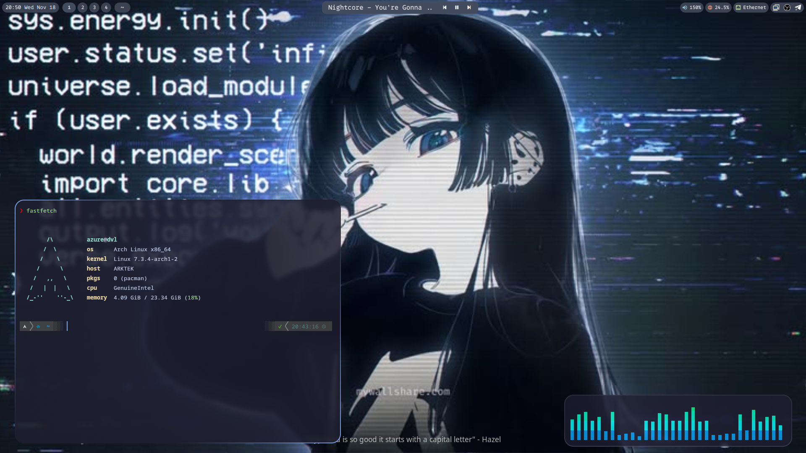
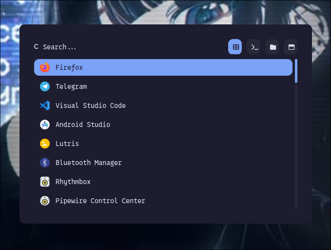
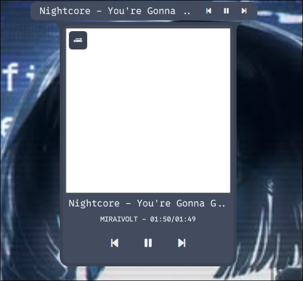
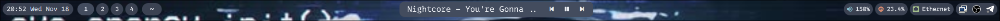

# azuredvl_doct_hyprland

Configuración personal de **Hyprland** para **Arch Linux**, escrita en **Lua**.

## Screenshots

### Fotos

| Escritorio | Apps / Launcher |
| --- | --- |
|  |  |

| QuickShell | |
| --- | --- |
|  |  |

### Video

<!-- Opción 1: video local (GitHub puede no reproducir todos los formatos en el README) -->
<video src="screenshots/my_docts.mp4" controls width="100%"></video>

## Instalación rápida

```bash
git clone https://github.com/Azure-dvl/azuredvl_doct_hyprland.git
cd azuredvl_doct_hyprland
sudo ./install.sh
```

El script instala los paquetes (oficiales + AUR), hace un **backup** de tu
`~/.config` actual en `~/dotfiles_backup/<fecha>`, copia las configuraciones y
avisa de lo que queda por ajustar a mano.

Opciones útiles:

```bash
./install.sh --help
sudo ./install.sh -n            # dry-run: no instala ni copia nada
sudo ./install.sh --no-packages # sólo copiar configuraciones
```

<details>
<summary>Instalación manual</summary>

### Requisitos previos

```bash
# yay (helper de AUR)
git clone https://aur.archlinux.org/yay.git
cd yay && makepkg -si
```

### Paquetes oficiales (pacman)

```bash
sudo pacman -S --needed \
    hyprland hypridle hyprpaper hyprlock hyprcursor hyprpolkitagent hyprpicker \
    xdg-desktop-portal-hyprland xdg-desktop-portal-gtk xdg-desktop-portal \
    xdg-utils xdg-user-dirs wl-clipboard cliphist grim slurp libnotify \
    quickshell waybar \
    pipewire pipewire-pulse wireplumber \
    networkmanager network-manager-applet nm-connection-editor \
    kitty zsh fzf fd bat ripgrep fastfetch htop btop git python \
    brightnessctl less file pciutils procps-ng gvfs gvfs-smb \
    rofi dunst thunar mpv gdm firefox pamixer pavucontrol blueman cava \
    qt6-base qt6-declarative qt6-svg qt6-wayland gtk3 hicolor-icon-theme \
    noto-fonts ttf-hack-nerd ttf-jetbrains-mono-nerd ttf-iosevka-nerd otf-font-awesome \
    acpi mpc mpd alsa-utils trash-cli \
    ranger libarchive poppler jq highlight python-pygments
```

### Paquetes AUR (yay)

```bash
yay -S --needed \
    tty-clock \
    grimblast-git \
    ttf-0xproto \
    tela-icon-theme-git \
    nordic-theme-git \
    bibata-cursor-theme-bin \
    hyprqt6engine \
    gtk-cyberpunk-neon-theme-git

# Opcional: Feather + Grape Nuts para los temas de rofi (paquete grande)
yay -S --needed nerd-fonts-git
```

### Copiar configuraciones

```bash
# Backup
mkdir -p ~/dotfiles_backup
cp -a ~/.config ~/dotfiles_backup/config_backup_$(date +%Y%m%d-%H%M%S)

# Copiar (-a preserva symlinks de rofi/scripts y permisos de los .sh)
cp -a .config/. ~/.config/
cp -a .wallpapers/. ~/.wallpapers/

# Regenerar cachés
fc-cache -f
```

### oh-my-zsh y powerlevel10k

```bash
sh -c "$(curl -fsSL https://raw.githubusercontent.com/ohmyzsh/ohmyzsh/master/tools/install.sh)"
git clone --depth=1 https://github.com/romkatv/powerlevel10k.git \
    ~/.oh-my-zsh/custom/themes/powerlevel10k
chsh -s /usr/bin/zsh
```

</details>

---

## Arquitectura

```
.config/
├── hypr/          Config del compositor (Lua)
│   ├── hyprland.lua        punto de entrada — require() del resto
│   ├── hyprland-gui.lua    ajustes gestionados por HyprMod (si existe)
│   ├── config.lua          xwayland → config/{env,monitors,input}
│   ├── keybind.lua, window_rule.lua, autostart.lua, programs.lua, theme.lua
│   ├── appearence/         animaciones + tema (feel.lua, colors.lua)
│   ├── hypridle.conf, hyprlock.conf, hyprpaper.conf
├── quickshell/    Barra, OSD, menús multimedia/apps (entry: shell.qml, `qs`)
├── rofi/          Lanzadores (type-1..7), powermenus (type-1..6), applets
├── waybar/        Alternativa a Quickshell (NO se autostartea)
├── kitty/, dunst/, cava/, ranger/, fastfetch/, htop/, hyprfm/
```

### Barra: Quickshell, no waybar

`~/.config/hypr/autostart.lua` arranca `qs & hyprpaper &` y `hypridle`. El entry point de
Quickshell es `~/.config/quickshell/shell.qml`, que carga:

| Componente | Qué hace |
|---|---|
| `Bar/Bar.qml` | Barra: workspaces, app actual, reloj, media, info del sistema, volumen, tray |
| `OSD.qml` | OSD de volumen (PipeWire) |
| `MediaMenu.qml` | Menú/control multimedia (MPRIS) |
| `AppMenu.qml` | Menú/lanzador de aplicaciones |

## Keybinds

| Combo | Acción |
|---|---|
| `SUPER + E` | Thunar (file manager) |
| `SUPER + T` | Kitty (terminal) |
| `SUPER + M` | Rofi launcher (`~/.config/rofi/launchers/type-1/launcher.sh`) |
| `SUPER + C` | `kitty cava` |
| `SUPER + O` | `kitty opencode` |
| `SUPER + L` | hyprlock |
| `SUPER + SHIFT + L` | Apagar sesión (`hyprshutdown` o `hyprctl dispatch exit`) |
| `SUPER + Q` | Cerrar ventana |
| `SUPER + V` | Flotar ventana (toggle) |
| `SUPER + F` | Pantalla completa |
| `SUPER + P` | Pseudo-tile |
| `SUPER + flechas` | Mover foco |
| `SUPER + 1..6` | Cambiar workspace |
| `SUPER + SHIFT + 1..6` | Mover ventana a workspace |
| `SUPER + scroll` | Workspace anterior/siguiente |
| `SUPER + arrastrar` | Mover / redimensionar ventana (LMB/RMB) |
| `Print` | Captura completa (`grimblast --notify copy output`) |
| `SHIFT + Print` | Captura de área (`grimblast --notify --freeze copy area`) |

## Paquetes por dependencia (de dónde sale cada cosa)

| Paquete | Lo exige |
|---|---|
| `hyprland` ≥ 0.56 | toda la API `hl.*` en `.config/hypr/` |
| `quickshell` (+ `qt6-*`, `gtk3`) | `quickshell/shell.qml`, `Bar/`, `OSD.qml`, `AppMenu.qml`, `MediaMenu.qml` |
| `hyprpaper` | `hypr/autostart.lua`, `hyprpaper.conf` |
| `hypridle` | `hypr/autostart.lua`, `hypridle.conf` |
| `hyprlock` | `keybind.lua`, `hypridle.conf` |
| `hyprpolkitagent` | agente de autenticación en `hypr/autostart.lua` |
| `brightnessctl` | `hypridle.conf` y utilidades del sistema |
| `grimblast-git` (AUR) | capturas en `keybind.lua` |
| `cliphist` + `wl-clipboard` | portapapeles en `autostart.lua` (`wl-paste --watch`) |
| `networkmanager` + `network-manager-applet` | `nm-applet` en `autostart.lua` e info de red en Quickshell |
| `dunst` | notificaciones (`autostart.lua`) |
| `thunar` | `programs.lua`, reglas de ventana en `window_rule.lua` |
| `kitty` | terminal por defecto (`programs.lua`, autostart, keybinds) |
| `rofi` | launcher configurado en `programs.lua` |
| `cava` | `SUPER + C` (`kitty cava`) |
| `pipewire` + `pipewire-pulse` + `wireplumber` | audio (Quickshell/Wayland) |
| `pavucontrol` | control de audio (reglas/scripts opcionales) |
| `blueman` | gestor Bluetooth (waybar/scripts) |
| `python` | utilidades/scripts de la configuración |
| `ttf-0xproto` (AUR) | fuente principal en Quickshell, hyprlock y tema GTK/waybar |
| `noto-fonts`, `ttf-hack-nerd`, `ttf-jetbrains-mono-nerd`, `ttf-iosevka-nerd`, `otf-font-awesome` | fuentes usadas por kitty, rofi, dunst, waybar y temas alternativos |
| `tela-icon-theme-git` (AUR) | iconos `Tela dracula` (`env.lua`, hyprfm) |
| `nordic-theme-git` (AUR) | tema GTK `Nordic` (`env.lua`) |
| `bibata-cursor-theme-bin` (AUR) | cursor `Bibata-Modern-*` |
| `htop`, `btop`, `fastfetch`, `ranger`, `mpv`, `firefox` | utilidades/apps incluidas en la config |
| `tty-clock` (AUR) | atajo comentado (`SUPER + H`) y utilidad opcional |

## Personalización

| Qué | Dónde |
|---|---|
| Monitores | `hypr/config/monitors.lua`, `hypr/hyprpaper.conf` (por defecto `DP-1`, `HDMI-A-2`) |
| Wallpapers | `hypr/hyprpaper.conf` → `~/.wallpapers/` (y capturas del README en `scrennshots/`) |
| Ratón / teclado | `hypr/config/input.lua` |
| Apps por defecto / launcher | `hypr/programs.lua` |
| Tema (color, fuente, cursor, iconos) | `hypr/appearence/theme/colors.lua`, `hypr/config/env.lua` |
| Animaciones | `hypr/appearence/animations.lua` |
| Reglas de ventanas | `hypr/window_rule.lua` |
| Autostart | `hypr/autostart.lua` |
| Tema de Quickshell | `quickshell/Theme.qml` y `quickshell/settings.json` |